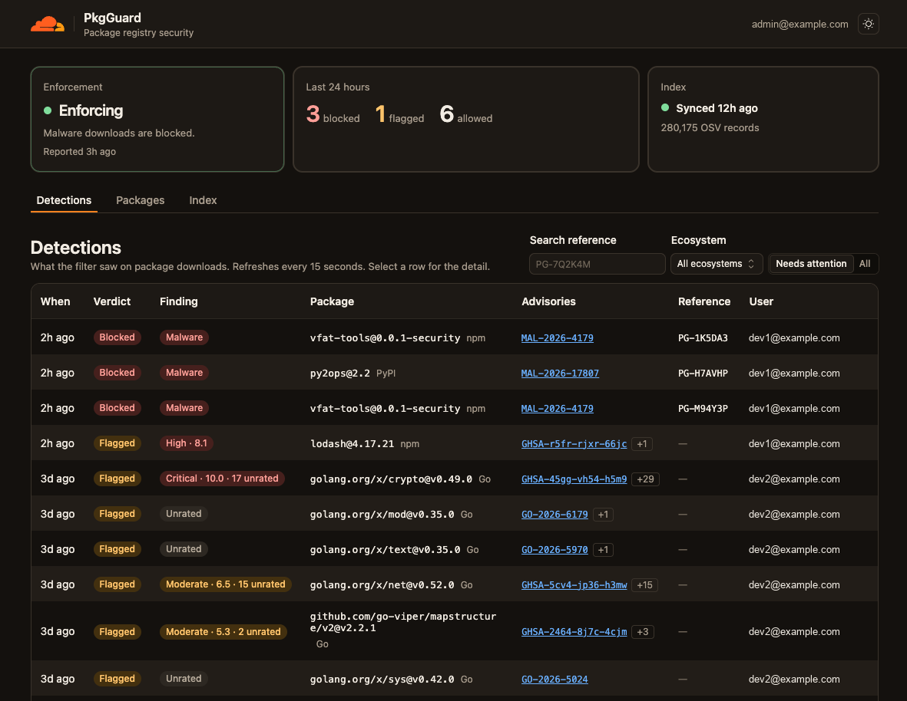
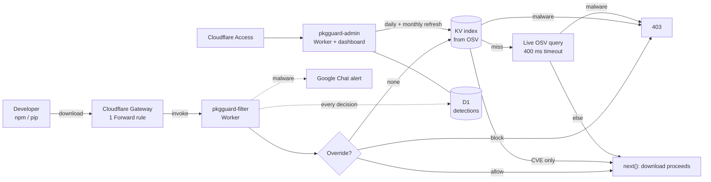

# PkgGuard

Block malicious npm, PyPI, Cargo, RubyGems, NuGet and Go packages at the network edge, using a live [OSV.dev](https://osv.dev) feed, without writing a policy per package.

PkgGuard is two Cloudflare Workers behind a single Cloudflare Gateway rule. When a developer on an enrolled device downloads a package, Gateway hands the request to a Worker. The Worker checks the package against an index built from OSV and either lets the download through or stops it. Malware is blocked. Ordinary vulnerabilities are logged, because blocking every CVE would break most real builds.



*The dashboard's Detections tab: what the filter saw on package downloads, with the enforcement state and index status above it. The addresses in the screenshot are examples.*

## Why

[Package Registry Security](https://developers.cloudflare.com/cloudflare-one/traffic-controls/http-policies/package-registry-security/) gives Gateway `pkg.*` selectors for allowing or blocking package downloads. That works for a handful of packages. It does not work for a live feed: OSV tracks hundreds of thousands of records, and Gateway allows 500 HTTP policies per account.

PkgGuard moves the decision out of the policy engine. The Gateway rule count stays at one, and the data scales on its own.

## How it works



| Component | Role |
|---|---|
| `pkgguard-filter` | Invoked by Gateway for every npm, PyPI, Cargo, RubyGems, NuGet and Go download. Decides, records, and either blocks or continues. No public route. |
| `pkgguard-admin` | Dashboard, REST API, the refresh Workflow and its crons. Behind Cloudflare Access. |
| D1 | Source of truth: advisories, detections, overrides, refresh history, audit log. Powers the dashboard. |
| KV | A flattened `ecosystem:name` index for fast reads on the download path, derived from D1. |
| `packages/core` | Pure TypeScript with no Workers APIs: one registry entry per ecosystem (URL parser, version ordering, name rules), OSV classification and range matching. Shared by both Workers and the bootstrap script. |

### What gets blocked

A record counts as **malware** if its ID or an alias starts with `MAL-`, **or** it carries a malicious-code weakness (CWE-506, 507, 510, 511 or 912). The weakness rule matters: well-known compromises such as `event-stream` are reviewed GitHub advisories with a `GHSA-` ID and no `MAL-` prefix, so a prefix check alone would miss them. Everything else is a **vulnerability**: recorded as `flagged`, never blocked.

The order of decisions is: an administrator's **allow** override, then a **block** override, then the KV index, then a live OSV query on an index miss. The filter **fails open**: an internal error lets the download proceed and is logged, because Gateway itself fails closed on a Worker error and would otherwise break installs.

### What a developer sees

The client decides what is worth sending, and what actually reaches a terminal is limited. This was tested against real npm, pip, cargo, gem, dotnet and go behind Gateway.

| Client | What the developer sees |
|---|---|
| **npm** | `E403`, with the reason, the advisory link, where to get help and a reference code on the error line |
| **pip** | `403 Client Error: Forbidden`. Nothing in the response reaches pip's output, at any verbosity. The detail is in the Chat alert and the dashboard |
| **cargo** | `failed to download from … got 403`, followed by the **whole response body**: the package, the reason, the advisory link and the reference. Nothing reaches the cache. The most informative of the six |
| **gem** | `bad response Forbidden 403 (<url>)`, and `gem fetch` exits 1 with nothing saved. Like pip, nothing from the response body reaches the terminal; the detail is in the Chat alert and the dashboard |
| **dotnet** (`restore`) | `Response status code does not indicate success: 403 (Forbidden)`, then an error naming the package URL; `restore` exits 1 and extracts nothing. Nothing from the response body reaches the terminal. The client retries a blocked download several times, so one attempt leaves several rows in the dashboard |
| **go** (`mod download`, `build`) | `reading https://proxy.golang.org/…zip: 403 Forbidden`, then `server response:` and **one line**: the package, the reason, the advisory, the reference and where to ask. The go command prints only the first line of the body, so PkgGuard puts everything there; and it sends every blocked download **twice** (it retries any 4xx with a fresh request) and prints the second answer. Nothing reaches the module cache, and it does not fall through to a direct fetch |
| **curl** | A plain-text message with the same detail |
| **Browser** | A self-contained page: no script, no external request, light and dark |

Every block gets a short reference such as `PG-7Q2K4M`. It appears in the response, the Chat alert and the dashboard, which can be searched by it, so the code a developer quotes finds the event.

## Requirements

- A Cloudflare account with Zero Trust and Gateway, including the **Forward** action (Beta) and Package Registry Security selectors.
- The Cloudflare One client on developer devices, with **TLS decryption** on. Gateway only classifies a download if the registry host is decrypted, so a Do Not Inspect rule covering a registry's application silently disables enforcement for that ecosystem.
- A zone for the admin hostname, an Access identity provider, and existing reusable Access policies that admit your people.
- Node 22 or later, and Terraform for the Access side.
- Optional: a Google Chat space with an incoming webhook, for alerts.

## Setup

Wrangler reserves the `CLOUDFLARE_API_TOKEN` variable for its own login, so keep API tokens in `TF_VAR_cloudflare_api_token` instead. If Wrangler reports an invalid token despite a valid login, that variable is the first thing to check.

Everything that identifies your account lives in a gitignored `.deploy.env`. The committed `wrangler.jsonc` files carry placeholders, and a generator writes the real ones before each deploy. It refuses to deploy while any placeholder remains.

```bash
npm install
npx wrangler login
cp .deploy.env.example .deploy.env       # fill in as you go
```

**1. Create the storage.** The database must be named `pkgguard-db`.

```bash
npx wrangler d1 create pkgguard-db       # D1 id  -> PKGGUARD_D1_ID
npx wrangler kv namespace create PKG_INDEX   # KV id  -> PKGGUARD_KV_ID
```

**2. Access and the service token** (Terraform). Never apply without reading the plan. See [terraform/README.md](terraform/README.md).

```bash
cd terraform
cp terraform.tfvars.example terraform.tfvars    # fill in; gitignored
export TF_VAR_cloudflare_api_token=... TF_VAR_cloudflare_account_id=...
terraform init && terraform plan -out=tfplan
```

After applying, put the `admin_aud` output in `PKGGUARD_ACCESS_AUD`.

**3. Load the advisory index.** This is for a fresh database: it applies every migration in `migrations/` in order, then the data. To rehearse first, run `generate --limit 200` and then `load --local`.

```bash
npm run bootstrap -- download
npm run bootstrap -- census     # review what the feed would do before loading it
npm run bootstrap -- generate
npm run bootstrap -- load --remote
```

`census` reports, for each ecosystem, the range boundaries and listed versions the comparator cannot read, names merged by normalisation, names too long for a KV key and records that would abort a batch. An unreadable range boundary leaves its range inert, so look at those; an unreadable listed version still matches the identical string. Add `--ecosystem <id>` to any of these to work on one ecosystem.

**4. Deploy both Workers.** The filter starts **observe-only**: it records what it would block and blocks nothing.

```bash
npm run deploy:filter
npm run deploy:admin
```

**5. Alerts** (optional). The webhook is a secret, never a config value.

```bash
printf '%s' "$WEBHOOK_URL" | npx wrangler secret put GCHAT_WEBHOOK -c workers/filter/wrangler.local.jsonc
printf '%s' "$WEBHOOK_URL" | npx wrangler secret put GCHAT_WEBHOOK -c workers/admin/wrangler.local.jsonc
```

**6. Create and enable the Gateway rule.** `create` always makes it disabled. Scope it in `.deploy.env`: `PKGGUARD_SCOPE` takes email addresses and `@domain` entries, and an empty value is an error, so the rule is never unscoped.

```bash
export TF_VAR_cloudflare_api_token=...
npm run gateway:rule -- create
npm run gateway:rule -- status
npm run gateway:rule -- enable
```

**7. Watch, then enforce.** Install a few packages and open the dashboard: it opens on **Detections**, with an **Enforcement** badge above the tabs. When the detections look right, set `PKGGUARD_ENFORCE=true` in `.deploy.env` and run `npm run deploy:filter`. The deploy prints the mode it wrote, and the badge shows what the filter itself reports once it has served a request. Until then it says "Not reported yet", which does not mean enforcement is off.

## Operating it

| Task | How |
|---|---|
| **Turn it off, fast** | `npm run gateway:rule -- disable`. It applies in a few seconds, and in testing malware downloaded normally within twelve. Rehearse it before you rely on it. |
| Turn it back on | `npm run gateway:rule -- enable` |
| Check the rule | `npm run gateway:rule -- status` reports the rule and any drift from the configured scope |
| Bring the rule up to date | `npm run gateway:rule -- sync` writes the configured scope and ecosystems over the live rule, prints each field it changes, and leaves it enabled or disabled as it was |
| Block or allow a package now | The dashboard's **Packages** tab: search a package and choose **Block** or **Allow**, or select a detection and choose **Add override**. Either prefills the form and saves nothing until you press Add. An allow beats a block, and both beat OSV. A change usually reaches the filter within seconds; KV propagation can take up to a minute. |
| Find what a developer hit | Paste the reference into the **Search reference** box on the **Detections** tab. Every reference belongs to a blocked or flagged download, so the default **Needs attention** view finds it |
| Check what the filter is doing | The **Enforcement** badge above the tabs: Enforcing, Enforcing except some ecosystems, Observe-only, or Not reported yet. It shows when the filter last reported, and says so when that is more than a day ago |
| Refresh the index | Daily at 04:00 UTC, monthly at 03:00 UTC, or the dashboard's refresh button. The monthly and daily runs are the same idempotent delta. |
| Stop enforcing without turning it off | Set `PKGGUARD_ENFORCE=false` and redeploy the filter: detections continue, nothing is blocked |
| Watch one ecosystem without blocking it | Set `PKGGUARD_OBSERVE_ONLY=<id>` (for example `pypi`) in `.deploy.env` and redeploy the filter: that ecosystem is recorded as flagged and never blocked, while the others still enforce. An unknown id fails the deploy |

Before **deleting** the filter Worker, delete or repoint the Gateway rule first. Deleting the Worker does not disable the rule, and matching requests then return `500`.

## Known limitations

- **Identity scoping.** A device with no identity (no active Cloudflare One session, or proxy-endpoint mode) does not match an identity-scoped rule, so its downloads are not filtered.
- **Two scopes, one audience.** The Forward rule's identity scope and your Do Not Inspect exemption for the registries are separate settings, and they must cover the same people. A user who is in the rule's scope but still on Do Not Inspect is **silently unfiltered**: the rule is enabled and in sync, malware downloads with no error, and nothing appears in the dashboard, so an empty dashboard looks like a clean one. Check each device's TLS issuer: `curl -sv https://registry.npmjs.org/ 2>&1 | grep issuer` must name Cloudflare, not the registry's own CA. Repeat for `pypi.org`, `files.pythonhosted.org`, `static.crates.io`, `index.crates.io`, `rubygems.org`, `index.rubygems.org`, `api.nuget.org`, `globalcdn.nuget.org` and `proxy.golang.org`.
- **pip.** A blocked `pip` user sees only `403 Forbidden` (see above).
- **Local caches bypass it.** PkgGuard decides on a download that crosses the network. A package already in pip's, npm's, cargo's, gem's, NuGet's or Go's local cache installs without one, so it is neither checked nor recorded. A package blocked as malware is never cached, because the block stops the download; the gap is a package cached *before* it was flagged. Tested: `pip download` of a cached wheel and `npm install` of a cached package both produced no detection. `pip --no-cache-dir` forces a fresh download.
- **Cargo coverage is mostly vulnerability logging.** crates.io removes malicious crates quickly: when this was measured, of the 31 malware records in OSV, 27 named crates already gone, and one still had a downloadable malicious version. Several records are for a single compromised version of a legitimate crate and list that version only, so the crate's other versions are unaffected. The value is the vulnerability log, and a block against a mirror that still serves what the registry dropped.
- **RubyGems: only plain `.gem` downloads are seen.** Gateway classifies `/gems/{name}-{version}.gem` as a `gem` package, and does not classify a platform build (`nokogiri-1.16.2-x86_64-linux.gem`, `-java.gem`, `-x64-mingw-ucrt.gem`) or the legacy `/downloads/` path. Measured with a temporary rule: the plain file was blocked, the others passed. PkgGuard is never invoked for them, so it can neither block nor record them. RubyGems clients normally choose a platform build over the plain one when a gem publishes both, so a malicious platform build would not be seen. The Worker's parser reads these names correctly; the gap is in what Gateway forwards.
- **RubyGems coverage is mostly vulnerability logging.** Of the 4,315 malware advisories, checking up to two versions of each (4,897 requests, metadata only, nothing opened) found one still downloadable: `resource_registry` 1.0.22. The registry has removed the rest. The value is the vulnerability log, and a block against a mirror that still serves what the registry dropped.
- **Old system Rubies print an SSL warning.** macOS's bundled Ruby 2.6 (RubyGems 3.0.3.1) prints `Root certificate is not trusted` through Gateway's decryption and then downloads anyway. The download succeeds and `SSL_CERT_FILE` did not silence it; a newer Ruby was not tested.
- **NuGet: look-alike ids are not seen.** Gateway does not forward a download whose id contains non-ASCII characters to the Worker. Measured by counting the Worker's own invocations: of seven requests, the four with ASCII ids invoked it and the three with Cyrillic look-alike ids did not. That matters here because **513 of the 782 NuGet malware packages (66%)** are named that way, and 5 of the 27 still-downloadable malicious versions are among them (for example `micrоsoft.entetyframeworkcore`). The Worker reads those ids correctly; they never reach it.
- **NuGet is where blocking pays off.** NuGet unlists a malicious package but keeps its files: of 961 malware versions checked (up to two per package, metadata only), **27 were still downloadable**, 22 of them with ASCII ids that PkgGuard blocks. That is far more than Cargo (1 of 31 records) or RubyGems (1 of 4,897 versions).
- **NuGet clients reach the Worker by two paths.** Current clients request `api.nuget.org/v3-flatcontainer/…`. The legacy v2 endpoint redirects to `globalcdn.nuget.org/packages/{id}.{version}.nupkg`, whose file name cannot be split into id and version without guessing, so the Worker tries every split and the index decides. Both are blocked.
- **Go: the public module proxy already refuses malicious modules, so PkgGuard's malware block is for mirrors.** `proxy.golang.org` answers a malicious module with a 403 and `SECURITY ERROR: The module proxy considers this module to be malicious and will not serve it`. Of the 21 modules in OSV's malware list, 11 got that answer, including the compromised `aquasecurity/trivy` v0.69.4, and the other 10 are simply not found, so none could be downloaded when this was measured. On the public proxy Go is a vulnerability log. A block matters against a private proxy or mirror (Athens, Artifactory and similar) that does not carry that protection.
- **Go: only proxy downloads are seen.** A module fetched with `GOPROXY=direct`, from a vendor directory, or from a private path that bypasses the proxy (`GOPRIVATE`, `GONOPROXY`) never crosses a registry URL. `go` stops on PkgGuard's 403 and does not fall through to `direct`, but a build configured to go direct is not covered.
- **Go: more requests reach the Worker than downloads.** Gateway also forwards some of the metadata requests (`.info`, `.mod`, the version list and `@latest`: 4 of the 6 sent in one test reached the Worker), which the Worker passes straight through and does not record, so a Go build costs a Worker invocation per module per request. And every blocked download leaves **two** rows and two references, because the go command retries it.
- **Go: module paths are case-sensitive, and names that cannot be downloaded are skipped.** `github.com/bishopfox/sliver` and `github.com/BishopFox/sliver` are two modules and two index entries (the proxy writes a capital as `!` and the lowercase letter, which the Worker decodes exactly). OSV's `stdlib`, `toolchain` and malformed `https://…` names are dropped, and 21 range boundaries that Go's own `semver` refuses (`19.03.9`, `9.6.0b1`) stay inert.
- **PyPI coverage is thinner than npm.** PyPI removes malicious packages quickly and most never get an OSV advisory. This is a property of the upstream data. PkgGuard supports PyPI, but it does not claim parity with npm.
- **Coverage gaps in Gateway.** The Forward action does not run for `CONNECT` tunnels, WebSocket traffic or protocol upgrades, and it needs the registry host to be TLS-decrypted.
- **Forward is a Beta feature**, and the Terraform provider does not yet support it, so the rule is managed through the API by `scripts/gateway-rule.ts`.
- **Only GET and POST.** The admin API avoids other HTTP methods because a zone's managed WAF can block them before they reach the Worker. Verify any new write against a deployed hostname, not only locally.
- **The Cloudflare One client's block notification** is a property of Gateway's Block action. A synthetic response from a Forward Worker does not trigger it.

## Development

```bash
npm test                  # the whole suite, never filtered
npm run typecheck
npm run test:coverage
npm run build:admin       # the dashboard, into workers/admin/dist
```

The tests run in the Workers runtime against real KV and D1 with the migrations applied. Security and correctness rules are checked by mutation: remove the rule, and a test has to fail.

```
packages/core/     pure TS: parsing, versions, OSV classification and matching, notifications
workers/filter/    the Gateway-invoked Worker: decide, record, alert, respond
workers/admin/     dashboard, API, refresh Workflow, crons (React + Kumo UI in ui/)
scripts/           bootstrap, deploy-config generator, Gateway rule manager
migrations/        D1 schema, applied in order
terraform/         the Access application and service token
```

[AGENTS.md](AGENTS.md) records the invariants a change must not break, such as the load-bearing `GatewayMiddleware` class name and the fail-open rule.

## License

MIT. See [LICENSE](LICENSE).
